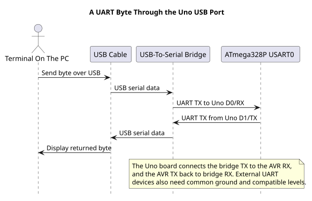

# UART Questions and Answers

## Questions

Use the [Uno UART path diagram](../assets/diagrams/uart-usb-path.svg) when tracing the receive and transmit direction.

1. How many bits are sent in an 8N1 UART frame?
2. At 9,600 baud, approximately how long does one 8N1 frame take?
3. Does `UDRE0` prove the final stop bit has left the TX pin?
4. Why can a blocking foreground task lose received UART bytes?
5. Why should an RS-232 cable not be connected directly to Uno D0 and D1?

## Answers

1. Ten: one start bit, eight data bits, no parity bit and one stop bit.
2. `10 / 9,600 s ≈ 1.042 ms`.
3. No. `UDRE0` means the transmit data register can accept another byte. `TXC0` reports completion of the full frame.
4. The USART has limited hardware buffering. If another frame arrives before software reads the pending data, the overrun flag can be set and data can be lost. A finite ring buffer gives foreground code more time but also has a capacity limit.
5. RS-232 uses different electrical voltage levels and polarity from the Uno's logic-level UART. Use a suitable transceiver.

## Continue Learning

Run the [UART echo lab](<https://github.com/arnabdasbwn/atmega328p-labs/blob/main/examples/14-uart-echo/main.c>), then compare it with the [interrupt queue](ring-buffer.md). Record baud, framing, terminal settings and any reported receive errors.

The [Rendered UART diagram](../assets/diagrams/uart-usb-path.svg) can be edited and rendered again with the course diagram command.

## Code Walkthrough

**Example code on GitHub:**
- [USART Register-Level Echo (`71-usart-register-echo`)](https://github.com/arnabdasbwn/atmega328p-labs/blob/main/examples/71-usart-register-echo/main.c)
- [Interrupt-driven USART receive queue (`47-uart-buffer`)](https://github.com/arnabdasbwn/atmega328p-labs/blob/main/examples/47-uart-buffer/main.c)

### USART Register-Level Echo
The example's `main()` configures its peripherals, runs the algorithm and reports or displays the result. These source operations are listed in execution order:

- `for (;;)` - Repeats the foreground task indefinitely; each pass checks inputs, advances the calculation or services the peripheral shown below.
- `if (usart_get(&received))` - Tests the stated condition; the following block handles the matching case and the other path is skipped.

Algorithm: Configures UBRR0, UCSR0A/B/C and UDR0 directly; checks RXC0 and per-byte FE0/DOR0/UPE0 before echoing.
Expected behaviour: Each error-free received byte is echoed once; malformed or timed-out receives are ignored
**HAL source files in this repository:** [ATmega328P HAL on GitHub](https://github.com/arnabdasbwn/atmega328p-hal)

### Bounded UART echo
The example's `main()` configures its peripherals, runs the algorithm and reports or displays the result. These source operations are listed in execution order:

- `(void)avr_uart_init(9600UL);` - Configures USART0 for asynchronous 8N1. It chooses a baud divisor and normal/double-speed mode, programs UBRR0/UCSR0A/UCSR0C, then enables receive and transmit in UCSR0B.
- `for (;;)` - Repeats the foreground task indefinitely; each pass checks inputs, advances the calculation or services the peripheral shown below.
- `avr_status_t status = avr_uart_get(&byte, AVR_POLL_BUDGET);` - Use the linked public header for this function's parameters, register ownership, blocking behavior and status values.
- `if (status == AVR_OK)` - Only enters the following block when the operation reports success.
- `(void)avr_uart_put(byte, AVR_POLL_BUDGET);` - Waits for the USART transmit buffer within its poll budget, then writes the byte to UDR0.

Algorithm: One 8N1 frame contains ten bits. At 9600 baud, a frame takes approximately 1.042 ms; the application must service reception before hardware buffering overflows.
Expected behaviour: Each received byte is echoed once
**HAL source files in this repository:** [ATmega328P HAL on GitHub](https://github.com/arnabdasbwn/atmega328p-hal)

- [`include/avr_hal/uart.h`](https://github.com/arnabdasbwn/atmega328p-hal/blob/main/include/avr_hal/uart.h)
- [`src/uart.c`](https://github.com/arnabdasbwn/atmega328p-hal/blob/main/src/uart.c)

### Interrupt-driven USART receive queue
The example's `main()` configures its peripherals, runs the algorithm and reports or displays the result. These source operations are listed in execution order:

- `if ((avr_uart_init(9600UL) != AVR_OK) || (avr_uart_rx_start() != AVR_OK))` - This checks for any setup or transfer error before the program continues. Configures USART0 for asynchronous 8N1. It chooses a baud divisor and normal/double-speed mode, programs UBRR0/UCSR0A/UCSR0C, then enables receive and transmit in UCSR0B. Enables the interrupt-driven USART receive queue. Start it after UART setup and enable global interrupts only when shared state is ready.
- `return 1;` - Stops this path and returns the indicated status when setup or validation cannot continue.
- `(void)avr_gpio_mode(13U, AVR_GPIO_OUTPUT);` - Maps the Uno header pin to its AVR port, sets its DDR direction bit and prepares the PORT latch for the requested initial level or pull-up.
- `(void)avr_gpio_mode(8U, AVR_GPIO_OUTPUT);` - Maps the Uno header pin to its AVR port, sets its DDR direction bit and prepares the PORT latch for the requested initial level or pull-up.
- `avr_tick_init();` - Configures the course millisecond tick interrupt source; it does not enable global interrupts itself.
- `uint32_t previous = 0UL;` - Clears the state/counter after its threshold is reached so the next interval starts from zero.
- `sei();` - Enables global interrupts after the example has configured its sources and shared state.
- `for (;;)` - Repeats the foreground task indefinitely; each pass checks inputs, advances the calculation or services the peripheral shown below.
- `if (avr_uart_rx_get(&value) == AVR_OK)` - The operation runs only after this API reports AVR_OK. Removes one byte from the receive queue without blocking; an empty queue returns a busy status.
- `(void)avr_uart_put(value, AVR_POLL_BUDGET);` - Waits for the USART transmit buffer within its poll budget, then writes the byte to UDR0.
- `uint32_t now = avr_tick_ms();` - Use the linked public header for this function's parameters, register ownership, blocking behavior and status values.
- `if (avr_elapsed(now, previous, 500UL))` - Tests this condition to choose which algorithm path runs.
- `previous = now;` - Stores this intermediate value for the next step of the algorithm; check the operands and units.
- `(void)avr_gpio_toggle(13U);` - Atomically toggles the selected pin output latch.
- `avr_uart_rx_stats_t stats;` - Use the linked public header for this function's parameters, register ownership, blocking behavior and status values.
- `(void)avr_uart_rx_stats(&stats);` - Use the linked public header for this function's parameters, register ownership, blocking behavior and status values.
- `if ((stats.dropped != 0U) || (stats.errors != 0U))` - Tests the stated condition; the following block handles the matching case and the other path is skipped.
- `(void)avr_gpio_write(8U, true);` - Changes the pin's PORT output latch; for an input pin this selects its pull-up state.

Algorithm: A finite single-producer/single-consumer queue separates the ISR from foreground processing; one slot distinguishes full from empty.
Expected behaviour: Echo received bytes while LED L toggles; D8 latches high after receive loss
**HAL source files in this repository:** [ATmega328P HAL on GitHub](https://github.com/arnabdasbwn/atmega328p-hal)

- [`include/avr_hal/gpio.h`](https://github.com/arnabdasbwn/atmega328p-hal/blob/main/include/avr_hal/gpio.h)
- [`include/avr_hal/tick.h`](https://github.com/arnabdasbwn/atmega328p-hal/blob/main/include/avr_hal/tick.h)
- [`include/avr_hal/uart.h`](https://github.com/arnabdasbwn/atmega328p-hal/blob/main/include/avr_hal/uart.h)
- [`include/avr_hal/uart_rx.h`](https://github.com/arnabdasbwn/atmega328p-hal/blob/main/include/avr_hal/uart_rx.h)
- [`lib/interrupts/tick.c`](https://github.com/arnabdasbwn/atmega328p-hal/blob/main/lib/interrupts/tick.c)
- [`lib/interrupts/uart_rx.c`](https://github.com/arnabdasbwn/atmega328p-hal/blob/main/lib/interrupts/uart_rx.c)
- [`src/gpio.c`](https://github.com/arnabdasbwn/atmega328p-hal/blob/main/src/gpio.c)
- [`src/uart.c`](https://github.com/arnabdasbwn/atmega328p-hal/blob/main/src/uart.c)
