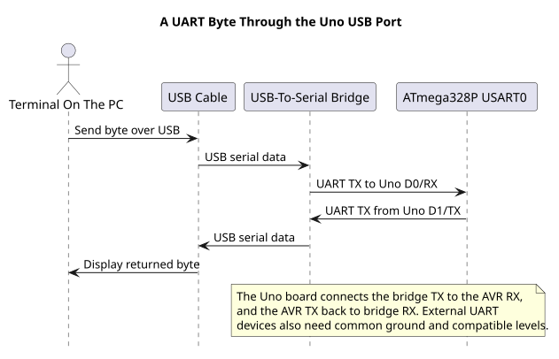

# ATmega328P USART Registers

## Configuration and Data Registers



| Register | Purpose |
| --- | --- |
| `UBRR0H:UBRR0L` | Baud-rate divisor |
| `UCSR0A` | Status flags, double-speed selection and multiprocessor mode |
| `UCSR0B` | Transmitter, receiver and interrupt enables |
| `UCSR0C` | Asynchronous/synchronous mode, parity, stop bits and data width |
| `UDR0` | Transmit data or the next received byte |

For asynchronous normal speed, the baud rate is approximately:

`baud = F_CPU / (16 x (UBRR0 + 1))`

At 16 MHz and 9600 baud, the ideal divisor is about 103.17. An integer divisor of 103 produces `16,000,000 / (16 x 104) = 9615.38 baud`, about +0.16 percent. In double-speed mode, `U2X0` changes the divisor from 16 to 8. Always calculate against the real clock and check the error against the receiving device's tolerance.

## Configure Asynchronous 8N1

For 8 data bits, no parity and one stop bit, clear the `UMSEL01:0`, `UPM01:0` and `USBS0` selections and set `UCSZ01:0`. In `UCSR0B`, set `RXEN0` and `TXEN0`. The [register-level Lab 71](<https://github.com/arnabdasbwn/atmega328p-labs/blob/main/examples/71-usart-register-echo/main.c>) shows this setup directly, without the HAL. It uses finite polling loops and does not enable interrupts.

Do not let the direct-register program and the UART HAL configure USART0 at the same time. D0/RX and D1/TX also connect to the Uno's USB-to-serial bridge. External devices on these pins can interfere with uploads or terminal traffic.

Build Lab 71 with either compiler to check the direct-register configuration:

```powershell
python atmega328p-labs/tools/build.py 71-usart-register-echo --compiler gcc
python atmega328p-labs/tools/build.py 71-usart-register-echo --compiler xc8
```

## Read Status Before the Data Byte

`RXC0` indicates that a received byte is ready. `UDRE0` means the transmit data register can accept another byte. It does not mean the previous frame has finished leaving the TX pin; `TXC0` indicates complete transmission.

`FE0`, `DOR0` and `UPE0` report framing, overrun and parity errors for the buffered receive byte. Read `UCSR0A` before reading `UDR0`, then inspect those flags before accepting the byte. Reading `UDR0` advances the receive buffer. If an error is present, define a recovery policy rather than silently treating the data as valid.

`TXC0` is write-one-to-clear. A direct write of one clears it; a read-modify-write can accidentally clear a flag that became set between the read and write. Follow the data sheet's prescribed write sequence. Other flags have their own rules, so do not treat every control/status register as ordinary memory.

## Decide Between Polling and Interrupts

Polling is straightforward when the application can spend time waiting and bytes arrive slowly enough. Use an interrupt receiver and a bounded ring buffer when bytes may arrive during other foreground work. The interrupt service routine should copy the byte and its error state into the queue, then return; parsing and long responses belong in foreground code. A finite buffer can still overflow, so the application needs an overflow counter or other explicit recovery.

## Exercises with Answers

1. **At 16 MHz, what baud rate does UBRR0=103 give in normal mode?**
   About 9615 baud, approximately +0.16 percent from 9600.
2. **Does `UDRE0=1` mean the final stop bit has left the TX pin?**
   No. It only means UDR0 can accept a new byte. Check `TXC0` when complete transmission matters.
3. **Why read status before `UDR0`?**
   The framing, overrun and parity flags belong to the buffered receive byte. Reading data advances the receive buffer.

## Code Walkthrough


**Example code on GitHub:**
- [Bounded UART echo (`14-uart-echo`)](https://github.com/arnabdasbwn/atmega328p-labs/blob/main/examples/14-uart-echo/main.c)

### USART Register-Level Echo
The example's `main()` configures its peripherals, runs the algorithm and reports or displays the result. These source operations are listed in execution order:

- `for (;;)` - Repeats the foreground task indefinitely; each pass checks inputs, advances the calculation or services the peripheral shown below.
- `if (usart_get(&received))` - Tests the stated condition; the following block handles the matching case and the other path is skipped.

Algorithm: Configures UBRR0, UCSR0A/B/C and UDR0 directly; checks RXC0 and per-byte FE0/DOR0/UPE0 before echoing.
Expected behaviour: Each error-free received byte is echoed once; malformed or timed-out receives are ignored
**HAL source files in this repository:** [ATmega328P HAL on GitHub](https://github.com/arnabdasbwn/atmega328p-hal)


### Bounded UART echo
The example's `main()` configures its peripherals, runs the algorithm and reports or displays the result. These source operations are listed in execution order:

- `(void)avr_uart_init(9600UL);` - Configures USART0 for asynchronous 8N1. It chooses a baud divisor and normal/double-speed mode, programs UBRR0/UCSR0A/UCSR0C, then enables receive and transmit in UCSR0B.
- `for (;;)` - Repeats the foreground task indefinitely; each pass checks inputs, advances the calculation or services the peripheral shown below.
- `avr_status_t status = avr_uart_get(&byte, AVR_POLL_BUDGET);` - Use the linked public header for this function's parameters, register ownership, blocking behavior and status values.
- `if (status == AVR_OK)` - Only enters the following block when the operation reports success.
- `(void)avr_uart_put(byte, AVR_POLL_BUDGET);` - Waits for the USART transmit buffer within its poll budget, then writes the byte to UDR0.

Algorithm: One 8N1 frame contains ten bits. At 9600 baud, a frame takes approximately 1.042 ms; the application must service reception before hardware buffering overflows.
Expected behaviour: Each received byte is echoed once
**HAL source files in this repository:** [ATmega328P HAL on GitHub](https://github.com/arnabdasbwn/atmega328p-hal)

- [`include/avr_hal/uart.h`](https://github.com/arnabdasbwn/atmega328p-hal/blob/main/include/avr_hal/uart.h)
- [`src/uart.c`](https://github.com/arnabdasbwn/atmega328p-hal/blob/main/src/uart.c)


## References

- Microchip, [ATmega328P device documentation](https://www.microchip.com/en-us/product/ATMEGA328P), USART register and baud-generation descriptions.
- [Register-level USART example](<https://github.com/arnabdasbwn/atmega328p-labs/blob/main/examples/71-usart-register-echo/main.c>) and [HAL header](https://github.com/arnabdasbwn/atmega328p-hal/blob/main/include/avr_hal/uart.h).
- [UART concepts](uart-concepts.md) and [UART programming](uart-programming.md).
