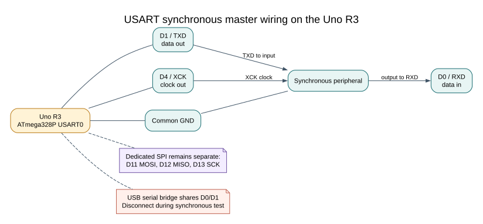

# USART Synchronous SPI Mode

## A Different Mode on the USART

The ATmega328P USART can operate synchronously as a master. In that mode it uses TXD, RXD and XCK rather than the dedicated SPI peripheral's MOSI, MISO and SCK pins. On the Uno, these signals are D1, D0 and D4 respectively. The serial data framing is synchronous, so an ordinary asynchronous serial terminal cannot communicate while this mode is active.

| USART Signal | Uno Pin | Direction In Synchronous Master Mode |
| --- | --- | --- |
| TXD | D1 | Data out |
| RXD | D0 | Data in |
| XCK | D4 | Clock out |

For the loopback lab, connect D1/TXD to D0/RXD and observe D4/XCK with a logic analyzer referenced to Uno GND. Upload the firmware over the USB serial port first, then close the terminal and disconnect USB before running synchronous mode so the bridge does not share D0/D1. Use a separate suitable power source while observing the waveform. Do not connect a second transmitter to either data pin.

The dedicated SPI pins remain D11/MOSI, D12/MISO and D13/SCK. These two hardware blocks use different pins, so check the board pin map before connecting a peripheral.

This can be useful when a design needs the dedicated SPI peripheral for one task and the USART's synchronous mode for another. It is not automatically a drop-in replacement: pin mapping, clock generation, data order, mode support and transfer logic must match the peripheral.



## Worked Clock Calculation

In master synchronous mode, the clock rate is derived from the CPU clock and UBRR. The maintained loopback example uses `UBRR0=7` at 16 MHz:

`f_XCK = 16 MHz / (2 × (7 + 1)) = 1 MHz`

The [USART synchronous example](<https://github.com/arnabdasbwn/atmega328p-labs/blob/main/examples/46-uart-spi/main.c>) loops D1/TXD back to D0/RXD and observes XCK on D4. D0/D1 are also connected to the Uno USB serial bridge, so the board should be disconnected from the computer during the synchronous test after firmware has been installed. Use the documented power and programming arrangement for the specific board; do not allow two transmitters to drive one line.

Build the example with both supported compilers before arranging a physical waveform check:

```powershell
python atmega328p-labs/tools/build.py 46-uart-spi --compiler gcc
python atmega328p-labs/tools/build.py 46-uart-spi --compiler xc8
```

No synchronous waveform or peripheral transaction has been physically verified.

## When to Use It

For most SPI peripherals, start with the dedicated SPI controller and its HAL. Choose USART synchronous mode only when you have a resource or pin-allocation reason and have checked the ATmega328P data sheet. Do not expect `Serial Monitor` logs from a USART configured for synchronous transfers.

## Exercise with Answer

Can a serial terminal communicate with the example while USART0 is configured in synchronous master mode?

**Answer:** No. The USART is generating a clock and synchronous data on its pins, not asynchronous UART frames for the USB serial interface.

## Code Walkthrough

### USART synchronous SPI controller mode
The example's `main()` configures its peripherals, runs the algorithm and reports or displays the result. These source operations are listed in execution order:

- `DDRD |= _BV(DDD4) | _BV(DDD1);` - Sets the Port D direction bits; a set bit selects output mode.
- `DDRD &= (uint8_t)~_BV(DDD0);` - Sets the Port D direction bits; a set bit selects output mode.
- `UCSR0B = 0U;` - Enables USART receive/transmit and optional USART interrupts.
- `UCSR0C = _BV(UMSEL01) | _BV(UMSEL00);` - Selects the USART frame format. UCSZ01:0 = 1:1 selects eight data bits; reset defaults give asynchronous, no parity and one stop bit.
- `UBRR0 = 7U;` - Sets the USART baud-rate divisor.
- `UCSR0B = _BV(TXEN0) | _BV(RXEN0);` - Enables USART receive/transmit and optional USART interrupts.
- `(void)avr_gpio_mode(13U, AVR_GPIO_OUTPUT);` - Maps the Uno header pin to its AVR port, sets its DDR direction bit and prepares the PORT latch for the requested initial level or pull-up.
- `for (;;)` - Repeats the foreground task indefinitely; each pass checks inputs, advances the calculation or services the peripheral shown below.
- `uint32_t budget = AVR_POLL_BUDGET;` - Stores this intermediate or output value for the next algorithm step. Check the units and range represented by each operand.
- `while ((UCSR0A & _BV(UDRE0)) == 0U && budget > 0UL)` - Contains USART status and speed-control flags, including transmit/receive readiness and U2X0.
- `--budget;` - This statement advances the operation sequence; follow its expression to see the state change.
- `if (budget == 0UL)` - Tests this condition to choose which algorithm path runs.
- `UDR0 = 0x5AU;` - USART transmit/receive data register.
- `budget = AVR_POLL_BUDGET;` - Stores this intermediate value for the next step of the algorithm; check the operands and units.
- `while ((UCSR0A & _BV(RXC0)) == 0U && budget > 0UL)` - Waits for this condition to change; the nearby counter or timeout limits how long it can block.
- `if (budget != 0UL)` - Tests the stated condition; the following block handles the matching case and the other path is skipped.
- `uint8_t value = UDR0;` - Holds the next USART byte to transmit or the received byte to read.
- `(void)avr_gpio_write(13U, value == 0x5AU);` - Changes the pin's PORT output latch; for an input pin this selects its pull-up state.
- `_delay_ms(100);` - Waits for the stated interval; the foreground does no other work during this blocking delay.

Algorithm: USART SPI mode uses a different pin set from the SPI peripheral and prevents normal serial-terminal use. At UBRR=7 the synchronous clock is 16 MHz/(2*8)=1 MHz.
Expected behaviour: L indicates synchronous 0x5A loopback
**HAL source files in this repository:** [ATmega328P HAL on GitHub](https://github.com/arnabdasbwn/atmega328p-hal)

- [`include/avr_hal/gpio.h`](https://github.com/arnabdasbwn/atmega328p-hal/blob/main/include/avr_hal/gpio.h)
- [`src/gpio.c`](https://github.com/arnabdasbwn/atmega328p-hal/blob/main/src/gpio.c)


## References

- [ATmega328P USART synchronous-mode documentation](https://www.microchip.com/en-us/product/ATMEGA328P)
- [USART synchronous example source and wiring](<https://github.com/arnabdasbwn/atmega328p-labs/blob/main/examples/46-uart-spi/main.c>)
- [SPI concepts](spi-concepts.md)
