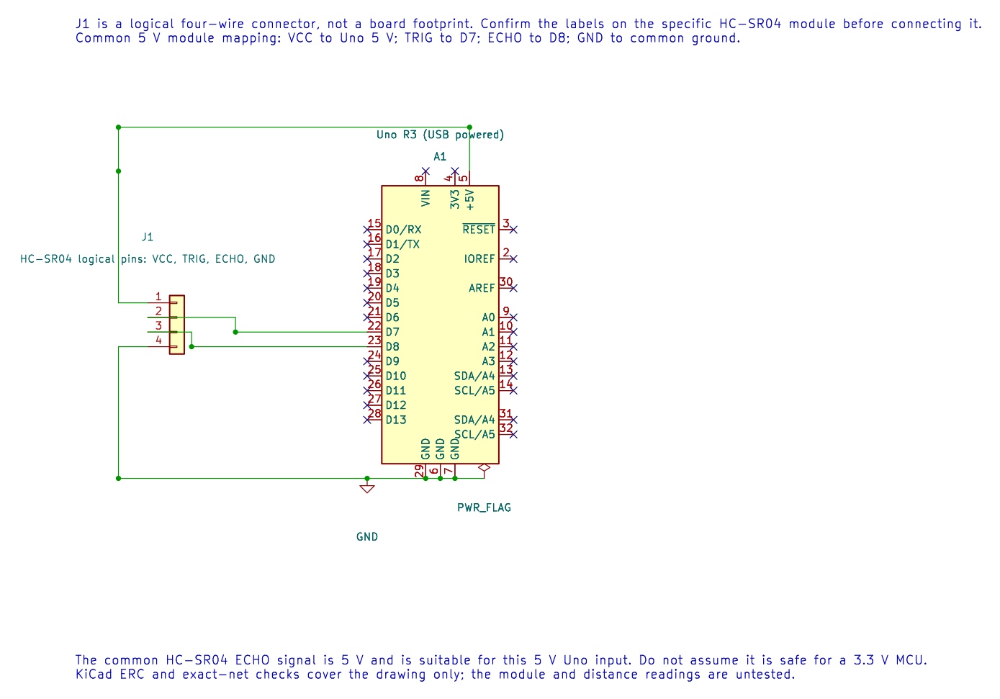

# HC-SR04 Ultrasonic Range Finder

## What You Will Learn

The HC-SR04 sends a short burst of sound and raises its ECHO output while it waits for the reflection. The Uno measures this pulse width and estimates the distance to a reflecting object. This exercise connects GPIO, timer counting, bounded polling and integer unit conversion.

## Parts and Wiring

The example assumes a common 5 V HC-SR04 module. Check your module's labels and data before connecting it; clone boards can vary.

| Uno R3 | HC-SR04 | Purpose |
| --- | --- | --- |
| 5 V | VCC | Module supply |
| GND | GND | Shared signal reference |
| D7 | TRIG | Start a measurement |
| D8 | ECHO | Receive the pulse-width signal |



For this 5 V Uno, the common HC-SR04 echo output can connect to a 5 V digital input. Do not reuse the wiring with a 3.3 V microcontroller without checking voltage compatibility.

## How the Distance Calculation Works

Sound travels from the sensor to the object and back. If the measured round-trip time is `t`, the one-way distance is:

```text
distance = speed_of_sound × t / 2
```

At room temperature, the example uses the approximation `distance_cm ≈ echo_time_us / 58`. For example, a 1,160 µs echo gives about `1160 / 58 = 20 cm`. Temperature changes the speed of sound, and angled or soft surfaces can weaken the echo.

## What the Firmware Does

Lab 31 raises D7 for at least 10 µs, then waits for D8 to go high and low. Timer1 supplies the pulse count at 0.5 µs per tick. Subtracting the start count from the end count with an unsigned 16-bit value handles one counter wrap when the pulse is shorter than the timer period. Dividing ticks by 116 produces an approximate number of centimetres.

The wait for an echo is bounded. If no pulse arrives, the program skips the distance output rather than reporting a false zero-centimetre result. Polling adds edge-detection latency; the separate input-capture lesson shows how the hardware can timestamp an edge more accurately.

## Build and Try the Lab

```powershell
python atmega328p-labs/tools/build.py 31-ultrasonic --compiler gcc
python atmega328p-labs/tools/build.py 31-ultrasonic --compiler xc8
```

After uploading through the course serial workflow, point the sensor squarely at a broad, hard surface. Read the centimetre values over serial and compare several positions with a ruler. The program waits about 70 ms between pings to reduce confusion from a previous reflection.

Build validation has passed. Physical wiring and measurements remain unverified because no HC-SR04 module was available.

## Code Walkthrough

### HC-SR04 echo pulse measurement
The example's `main()` configures its peripherals, runs the algorithm and reports or displays the result. These source operations are listed in execution order:

- `(void)avr_gpio_mode(7U, AVR_GPIO_OUTPUT);` - Maps the Uno header pin to its AVR port, sets its DDR direction bit and prepares the PORT latch for the requested initial level or pull-up.
- `(void)avr_gpio_mode(8U, AVR_GPIO_INPUT);` - Maps the Uno header pin to its AVR port, sets its DDR direction bit and prepares the PORT latch for the requested initial level or pull-up.
- `(void)avr_uart_init(9600UL);` - Configures USART0 for asynchronous 8N1. It chooses a baud divisor and normal/double-speed mode, programs UBRR0/UCSR0A/UCSR0C, then enables receive and transmit in UCSR0B.
- `for (;;)` - Repeats the foreground task indefinitely; each pass checks inputs, advances the calculation or services the peripheral shown below.
- `(void)avr_timer1_capture(8U, true);` - Starts Timer1 input capture at ICP1 (Uno D8), choosing the edge and prescaler. The application still owns any capture ISR and overflow accounting.
- `(void)avr_gpio_write(7U, true);` - Changes the pin's PORT output latch; for an input pin this selects its pull-up state.
- `_delay_us(10);` - Waits for the stated interval; the foreground does no other work during this blocking delay.
- `(void)avr_gpio_write(7U, false);` - Changes the pin's PORT output latch; for an input pin this selects its pull-up state.
- `if (wait_level(true))` - Tests the stated condition; the following block handles the matching case and the other path is skipped.
- `uint16_t start = TCNT1;` - Holds the live 16-bit Timer1 count; writing zero starts from a known count.
- `if (wait_level(false))` - Tests this condition to choose which algorithm path runs.
- `uint16_t ticks = (uint16_t)(TCNT1 - start);` - Holds the live 16-bit Timer1 count; writing zero starts from a known count.
- `(void)avr_uart_u16((uint16_t)(ticks / 116U));` - Formats an unsigned integer as decimal digits and sends them on USART0; it does not add a newline.
- `(void)avr_uart_put('\n', AVR_POLL_BUDGET);` - Waits for the USART transmit buffer within its poll budget, then writes the byte to UDR0.
- `_delay_ms(70);` - Waits for the stated interval; the foreground does no other work during this blocking delay.

Algorithm: At 0.5 us per tick, centimetres are approximately ticks/116. The round trip requires a factor of two. Polling introduces edge latency; the separate input-capture lesson removes that timing uncertainty.
Expected behaviour: Prints approximate range in centimetres when an echo arrives
**HAL source files in this repository:** [ATmega328P HAL on GitHub](https://github.com/arnabdasbwn/atmega328p-hal)

- [`include/avr_hal/gpio.h`](https://github.com/arnabdasbwn/atmega328p-hal/blob/main/include/avr_hal/gpio.h)
- [`include/avr_hal/timer.h`](https://github.com/arnabdasbwn/atmega328p-hal/blob/main/include/avr_hal/timer.h)
- [`include/avr_hal/uart.h`](https://github.com/arnabdasbwn/atmega328p-hal/blob/main/include/avr_hal/uart.h)
- [`src/gpio.c`](https://github.com/arnabdasbwn/atmega328p-hal/blob/main/src/gpio.c)
- [`src/timer.c`](https://github.com/arnabdasbwn/atmega328p-hal/blob/main/src/timer.c)
- [`src/uart.c`](https://github.com/arnabdasbwn/atmega328p-hal/blob/main/src/uart.c)


## Common Problems

- **No reading appears:** Check TRIG/ECHO direction, common ground and module power. The example does not print an explicit timeout message.
- **Values jump:** Move the target, avoid angled surfaces and keep nearby objects outside the beam.
- **The reading is consistently biased:** Check the target distance and remember that sound speed changes with temperature; polling edge latency also affects the measurement.
- **The sensor freezes the program:** Every echo wait must remain bounded. Do not replace the timeout with an infinite loop.

## Check Your Understanding

1. Why is the measured distance divided by two?
2. What approximate distance corresponds to a 580 µs echo?
3. Why is “no echo” different from a zero-centimetre measurement?

**Suggested answers:** The pulse measures travel to the target and back. `580 / 58` gives approximately 10 cm. Zero is a valid numeric distance near the sensor; a timeout means no usable echo arrived, so the measurement is invalid.

## Source and Further Reading

- [Lab 31 source](<https://github.com/arnabdasbwn/atmega328p-labs/blob/main/examples/31-ultrasonic/main.c>)
- [ATmega328P Datasheet And Errata](https://www.microchip.com/en-us/product/ATMEGA328P), timer and GPIO chapters.
