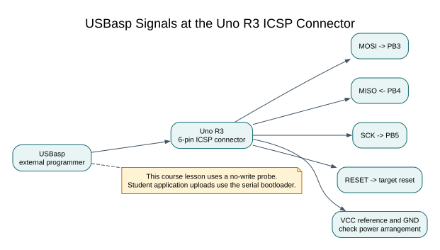

# Usbasp and ISP Programming

## ISP and the Uno Bootloader

In-system programming (ISP) uses the ATmega328P's SPI programming interface to read or write device memory while the chip is mounted on a board. A USBasp is one type of external ISP programmer. The Uno also has a six-pin ICSP connector connected to the target microcontroller.

ISP is useful for read-only device identification, recovery work and boards that have no working bootloader. An application can normally be uploaded through the Uno's serial bootloader, which is the preferred course workflow. ISP does not mean “safe by default”: an erase operation or the wrong image can remove the bootloader or change device settings.

## Uno Icsp Signals

| ICSP signal | ATmega328P pin role | Uno connection |
| --- | --- | --- |
| MISO | PB4 / MISO | Programmer data from target |
| MOSI | PB3 / MOSI | Programmer data to target |
| SCK | PB5 / SCK | Serial programming clock |
| RESET | RESET | Holds the target in programming mode |
| VCC | Target supply reference | Connect only as permitted by the programmer and board power arrangement |
| GND | Ground reference | Common ground |

Use the connector key and the board schematic to confirm orientation. Do not infer pin 1 from a drawing viewed from the opposite side. Check whether the programmer supplies target power before connecting VCC; avoid powering the Uno from two sources unless the board and programmer instructions explicitly allow it. Keep the JTAGICE3 or other debugger disconnected unless its wiring and mode are part of the planned test.



## Identify the Target Without Writing

Install AVRDUDE and the USBasp driver from their trusted project or vendor sources. Close the serial monitor and any other application that may own the programmer. A verbose, no-write probe is a useful first check:

```powershell
avrdude -c usbasp -p m328p -n -v
```

The output should identify the ATmega328P signature as `1E 95 0F` and report the target voltage when supported. If the signature is missing or unstable, stop and check orientation, ground, target power and programmer clock settings. Do not try random fuse values to make a programmer connect.

## Preserve Flash and Fuses

An ISP write can affect the boot section depending on the command, image and erase behaviour. Before any write, confirm the exact part, make a verified backup when appropriate, inspect the HEX address range and read the fuse bytes. Use an application-only image and a workflow that explicitly disables automatic chip erase. Never choose **Burn Bootloader** for a normal application update; that operation is intended to set fuse configuration and program a bootloader.

This course uses the checked `upload.py` route for student application uploads. The optional ISP topic teaches the interface and read-only identification; it is not a reason to flash a student's board. Fuse configuration is outside the beginner labs. If an ISP recovery is needed, follow the programmer and device documentation for the exact board and obtain a known-good bootloader image.

## Exercise with Answer

The programmer reports a signature different from `1E 95 0F`. What should you do before attempting a write?

**Answer:** Stop. Confirm the board and exact microcontroller, connector orientation, signal wiring and target supply. A different signature may mean another device is connected or the communication is unreliable. Do not write an image or change fuses until the target is identified.

## Code Walkthrough


**Example code on GitHub:**
- [Register-level Blink (`01-blink-register`)](https://github.com/arnabdasbwn/atmega328p-labs/blob/main/examples/01-blink-register/main.c)

### Register-level Blink
The example's `main()` configures its peripherals, runs the algorithm and reports or displays the result. These source operations are listed in execution order:

- `PORTB &= (uint8_t)~_BV(PORTB5);` - Sets or clears the Port B output latch. When the pin is an output, this determines its output level; on an input, it controls the pull-up.
- `DDRB |= _BV(DDB5);` - Sets the Port B direction bits; a set bit selects output mode.
- `for (;;)` - Repeats the foreground task indefinitely; each pass checks inputs, advances the calculation or services the peripheral shown below.
- `PINB = _BV(PINB5);` - Writing a one to a PINB bit toggles that pin's PORTB output latch on the ATmega328P.
- `_delay_ms(500);` - Waits for the stated interval; the foreground does no other work during this blocking delay.

Algorithm: Pin direction and output latch are separate hardware state.
Expected behaviour: L toggles every 500 ms
**HAL source files in this repository:** [ATmega328P HAL on GitHub](https://github.com/arnabdasbwn/atmega328p-hal)


## References

- [ATmega328P product page and documentation](https://www.microchip.com/en-us/product/ATMEGA328P)
- [Arduino Uno R3 schematic](https://docs.arduino.cc/resources/schematics/A000066-schematics.pdf)
- [Arduino bootloader overview](https://docs.arduino.cc/retired/hacking/software/Bootloader)
- [Upload through the Uno bootloader](upload-usb.md)
