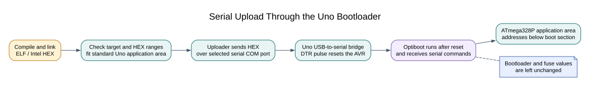

# Upload Uno R3 Firmware Through USB



## What Happens During an Upload?

The Uno's USB interface presents a serial port to the computer. When an upload starts, the board resets and its bootloader receives the compiled program over the ATmega328P UART. The bootloader writes the application into Flash and then starts it. This process does not require an external ISP programmer when the bootloader and serial reset path are working.

The course separates compilation from upload. First build and inspect the `.hex` file. Then confirm the target board and port before asking the uploader to write it. A successful build does not tell you whether the board received the image.

## Build and Check the Image

From the course root, build the register-level Blink lab:

```powershell
python "atmega328p-labs/tools/build.py" 01-blink-register --compiler xc8
```

The HEX file is written under `atmega328p-labs/build/xc8/01-blink-register/`. The build report records the compiler command and Flash/static-SRAM use. Review the selected target and confirm that the image fits below the Uno bootloader region.

## Start with a Dry Run

Close the serial monitor and use the COM port shown in Device Manager. Replace `COM4` below with the port assigned to your board:

```powershell
python "atmega328p-labs/tools/upload.py" "atmega328p-labs/build/xc8/01-blink-register/firmware.hex" --port COM4
```

The default mode prints the proposed AVRDUDE command without uploading. Check the image path, port and board. To perform the upload, add `--upload`:

```powershell
python "atmega328p-labs/tools/upload.py" "atmega328p-labs/build/xc8/01-blink-register/firmware.hex" --port COM4 --upload
```

The course uploader checks Intel HEX checksums, rejects application data at or above `0x7E00`, disables automatic chip erase and issues a Flash write only. It does not change fuses or lock bits. Do not use **Burn Bootloader** for an application upload; that is a different operation that can erase Flash and alter fuse configuration.

## Expected Result and Troubleshooting

After a successful upload, the bootloader starts the application. The onboard LED should follow the Blink lab's timing. If upload fails, check the selected board, current COM port, USB cable and whether another application holds the port. A timeout or sync error means the computer did not complete the bootloader exchange; it is not fixed by changing the application source at random.

The reference Uno's Optiboot image has been verified in Flash, but the bootloader did not respond to a serial synchronization request while the debugWIRE fuse remained unchanged. The serial upload path is therefore not currently verified on that board. The course did not change its fuses. This limitation does not affect ordinary build validation.

## Exercise with Answer

Why does the course uploader reject a HEX record that reaches address `0x7E00`?

**Answer:** `0x7E00` is the start of the Uno's 512-byte Optiboot region. An application image must stay below it so that a normal serial bootloader upload cannot replace the bootloader.

## Code Walkthrough


**Example code on GitHub:**
- [Register-level Blink (`01-blink-register`)](https://github.com/arnabdasbwn/atmega328p-labs/blob/main/examples/01-blink-register/main.c)

### Register-level Blink
The example's `main()` configures its peripherals, runs the algorithm and reports or displays the result. These source operations are listed in execution order:

- `PORTB &= (uint8_t)~_BV(PORTB5);` - Sets or clears the Port B output latch. When the pin is an output, this determines its output level; on an input, it controls the pull-up.
- `DDRB |= _BV(DDB5);` - Sets the Port B direction bits; a set bit selects output mode.
- `for (;;)` - Repeats the foreground task indefinitely; each pass checks inputs, advances the calculation or services the peripheral shown below.
- `PINB = _BV(PINB5);` - Writing a one to a PINB bit toggles that pin's PORTB output latch on the ATmega328P.
- `_delay_ms(500);` - Waits for the stated interval; the foreground does no other work during this blocking delay.

Algorithm: Pin direction and output latch are separate hardware state.
Expected behaviour: L toggles every 500 ms
**HAL source files in this repository:** [ATmega328P HAL on GitHub](https://github.com/arnabdasbwn/atmega328p-hal)


## References

- [Arduino Uno R3 documentation](https://docs.arduino.cc/hardware/uno-rev3/)
- [Arduino bootloader overview](https://docs.arduino.cc/retired/hacking/software/Bootloader)
- [Lab build and upload instructions](https://github.com/arnabdasbwn/atmega328p-labs/blob/main/README.md)
- [Flash, SRAM, EEPROM and AVR address spaces](memory-architecture.md)
