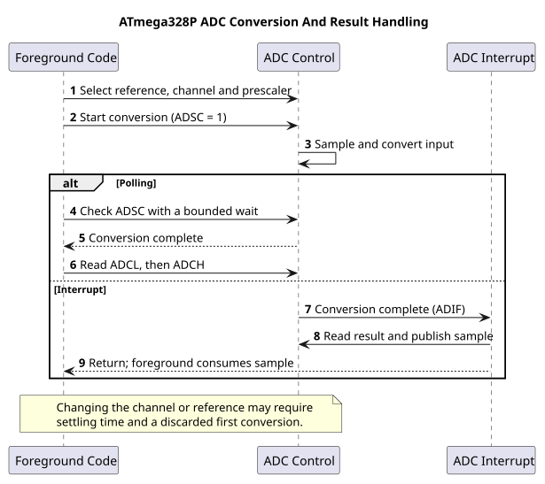

# Volatile and Atomic Access

## Two Different Questions

`volatile` tells the compiler that accesses to an object are observable and its
value may change outside the current ordinary control flow. It is appropriate for
peripheral registers and selected ISR-shared variables. It does **not** make a
multi-instruction operation indivisible, lock a data structure, or make every
read-modify-write safe.

An atomic operation cannot be interrupted halfway by the competing activity being
considered. On the eight-bit AVR, reading a 32-bit software tick requires multiple
byte accesses. The objective here is to explain a torn read and take a consistent
snapshot without printing or waiting inside a critical section.

## A Torn-Read Example

Imagine a 16-bit counter changing from `0x00FF` to `0x0100` in an ISR. Foreground
code reads the low byte first, getting `0xFF`. The ISR runs and updates the counter.
Foreground then reads the new high byte, `0x01`. It assembles `0x01FF`: a value the
counter never held. Declaring the counter `volatile` ensures the reads occur; it
does not prevent this interleaving. The exact byte order is compiler-dependent,
but neither order alone solves the consistency problem.

| Step | Foreground | Interrupt |
| --- | --- | --- |
| 1 | Read old low byte `FF` | — |
| 2 | Suspended | Increment `00FF` to `0100` |
| 3 | Read new high byte `01` | Finished |
| 4 | Assemble incorrect `01FF` | — |

## Snapshot, Then Process

The [tick implementation](https://github.com/arnabdasbwn/atmega328p-hal/blob/main/lib/interrupts/tick.c) declares the
counter volatile, increments it in one short ISR, and copies it inside
`ATOMIC_BLOCK(ATOMIC_RESTORESTATE)`. The block saves and restores the prior interrupt
state. A function must not assume interrupts were enabled on entry and blindly
enable them on return.

The [ADC interrupt example](<https://github.com/arnabdasbwn/atmega328p-labs/blob/main/examples/39-adc-interrupt/main.c>)
transfers a result and its ready flag together. Foreground takes both under the
same short critical section, clears the flag, then prints outside the section.
Transferring only the sample atomically while clearing the flag later could erase
notification of a new sample. This example has one outstanding conversion at a
time; a continuous stream needs a queue and an overflow policy.

## Keep the Protected Region Short

At 9600 baud, a ten-bit serial frame takes about 1.04 ms. Printing many characters
with interrupts disabled would delay timer and input events. The protected region
should copy a few bytes or update an index, then restore interrupts. Perform
conversion, formatting and transmission afterward.

An eight-bit load or store may be one instruction, but `count++` still needs a
read, modification and write. If both foreground and an ISR modify it, its width
alone is insufficient. Prefer one writer and explicit ownership. Peripheral
16-bit registers may have additional temporary-register access rules; a software
atomic block does not replace reading those rules.

## Build and Inspection Exercise

Build `10-scheduler` and `39-adc-interrupt` with both compiler profiles. Open their
sources and identify the only ISR writer and every foreground reader. Use the
map/disassembly workflow in [build and link](build-link.md) to inspect the tick
snapshot. No external circuit is needed merely to inspect generated instructions;
the ADC demonstration itself needs its documented potentiometer circuit.

## Exercises with Answers

1. Can a volatile flag be used as a lock against an ISR? **Answer:** merely checking
   then setting it is not atomic. Define a suitable critical section or one-writer
   protocol instead.
2. Why restore SREG rather than always call `sei()`? **Answer:** the caller may
   intentionally have entered with interrupts disabled.
3. Does an atomic snapshot prevent a slow consumer losing events? **Answer:** no.
   It prevents a torn snapshot. Buffering and a defined overflow policy address
   throughput mismatch.

For current device details, use the [Microchip ATmega328P documentation](https://www.microchip.com/en-us/product/ATMEGA328P). Check the document listed for your exact device and package; board-level pin labels and circuitry are covered by the [Uno R3 pinout](https://www.arnabkumardas.com/pinout/arduino-uno-r3/).

## Code Walkthrough

**Example code on GitHub:**
- [Interrupt tick and cooperative tasks (`10-scheduler`)](https://github.com/arnabdasbwn/atmega328p-labs/blob/main/examples/10-scheduler/main.c)

### Interrupt tick and cooperative tasks
The example's `main()` configures its peripherals, runs the algorithm and reports or displays the result. These source operations are listed in execution order:

- `uint32_t led_start = 0UL, report_start = 0UL;` - Clears the state/counter after its threshold is reached so the next interval starts from zero.
- `(void)avr_gpio_mode(13U, AVR_GPIO_OUTPUT);` - Maps the Uno header pin to its AVR port, sets its DDR direction bit and prepares the PORT latch for the requested initial level or pull-up.
- `(void)avr_uart_init(9600UL);` - Configures USART0 for asynchronous 8N1. It chooses a baud divisor and normal/double-speed mode, programs UBRR0/UCSR0A/UCSR0C, then enables receive and transmit in UCSR0B.
- `avr_tick_init();` - Configures the course millisecond tick interrupt source; it does not enable global interrupts itself.
- `sei();` - Enables global interrupts after the example has configured its sources and shared state.
- `for (;;)` - Repeats the foreground task indefinitely; each pass checks inputs, advances the calculation or services the peripheral shown below.
- `uint32_t now = avr_tick_ms();` - Use the linked public header for this function's parameters, register ownership, blocking behavior and status values.
- `if (avr_elapsed(now, led_start, 500UL))` - This branch runs only after the requested interval has elapsed. Uses unsigned subtraction to test elapsed time safely across a 32-bit tick wraparound.
- `led_start = now;` - Stores this intermediate or output value for the next algorithm step. Check the units and range represented by each operand.
- `(void)avr_gpio_toggle(13U);` - Atomically toggles the selected pin output latch.
- `if (avr_elapsed(now, report_start, 1000UL))` - This branch runs only after the requested interval has elapsed. Uses unsigned subtraction to test elapsed time safely across a 32-bit tick wraparound.
- `report_start = now;` - Stores this intermediate or output value for the next algorithm step. Check the units and range represented by each operand.
- `(void)avr_uart_u16((uint16_t)(now / 1000UL));` - Formats an unsigned integer as decimal digits and sends them on USART0; it does not add a newline.
- `(void)avr_uart_put('\n', AVR_POLL_BUDGET);` - Waits for the USART transmit buffer within its poll budget, then writes the byte to UDR0.

Algorithm: The ISR increments a tick; foreground code snapshots it atomically. Unsigned subtraction remains valid across wraparound for the documented interval range.
Expected behaviour: LED toggles twice per second while elapsed seconds print independently
**HAL source files in this repository:** [ATmega328P HAL on GitHub](https://github.com/arnabdasbwn/atmega328p-hal)

- [`include/avr_hal/gpio.h`](https://github.com/arnabdasbwn/atmega328p-hal/blob/main/include/avr_hal/gpio.h)
- [`include/avr_hal/tick.h`](https://github.com/arnabdasbwn/atmega328p-hal/blob/main/include/avr_hal/tick.h)
- [`include/avr_hal/uart.h`](https://github.com/arnabdasbwn/atmega328p-hal/blob/main/include/avr_hal/uart.h)
- [`lib/interrupts/tick.c`](https://github.com/arnabdasbwn/atmega328p-hal/blob/main/lib/interrupts/tick.c)
- [`src/gpio.c`](https://github.com/arnabdasbwn/atmega328p-hal/blob/main/src/gpio.c)
- [`src/uart.c`](https://github.com/arnabdasbwn/atmega328p-hal/blob/main/src/uart.c)

### ADC conversion-complete event
The example's `main()` configures its peripherals, runs the algorithm and reports or displays the result. These source operations are listed in execution order:

- `(void)avr_uart_init(9600UL);` - Configures USART0 for asynchronous 8N1. It chooses a baud divisor and normal/double-speed mode, programs UBRR0/UCSR0A/UCSR0C, then enables receive and transmit in UCSR0B.
- `(void)avr_adc_init(AVR_ADC_AVCC);` - Selects the reference in ADMUX and enables the ADC in ADCSRA with a divide-by-128 prescaler. At 16 MHz, the ADC clock is 125 kHz. The HAL keeps the result right-adjusted, waits for reference settling and leaves ADC interrupts disabled.
- `ADMUX = (uint8_t)(ADMUX & 0xF0U);` - Clears the ADMUX channel-selection nibble to choose ADC0 while preserving REFS1:0 reference settings.
- `ADCSRA |= _BV(ADIF);` - Writes one to ADIF to clear a pending ADC completion flag; ADIF is write-one-to-clear.
- `ADCSRA |= _BV(ADIE);` - Sets ADIE so ADC conversion completion requests the configured ADC interrupt.
- `sei();` - Enables global interrupts after the example has configured its sources and shared state.
- `for (;;)` - Repeats the foreground task indefinitely; each pass checks inputs, advances the calculation or services the peripheral shown below.
- `ADCSRA = (uint8_t)((ADCSRA & (uint8_t)~_BV(ADIF)) | _BV(ADSC));` - Controls ADC enable, prescaling, conversion start and optional interrupt. ADSC starts a conversion; ADIF is write-one-to-clear.
- `uint32_t budget = AVR_POLL_BUDGET;` - Stores this intermediate or output value for the next algorithm step. Check the units and range represented by each operand.
- `while (ready == 0U && budget > 0UL)` - Waits for this condition to change; inspect the nearby counter or budget to see the bound on blocking.
- `--budget;` - This statement advances the operation sequence; follow its expression to see the state change.
- `uint16_t sample = 0U;` - Clears the state/counter after its threshold is reached so the next interval starts from zero.
- `bool available = false;` - Stores this intermediate or output value for the next algorithm step. Check the units and range represented by each operand.
- `if (ready != 0U)` - Tests the stated condition; the following block handles the matching case and the other path is skipped.
- `sample = latest;` - Stores this intermediate value for the next step of the algorithm; check the operands and units.
- `ready = 0U;` - Clears the state/counter after its threshold is reached so the next interval starts from zero.
- `available = true;` - Stores this intermediate or output value for the next algorithm step. Check the units and range represented by each operand.
- `if (available)` - Tests the stated condition; the following block handles the matching case and the other path is skipped.
- `(void)avr_uart_u16(sample);` - Formats an unsigned integer as decimal digits and sends them on USART0; it does not add a newline.
- `(void)avr_uart_put('\n', AVR_POLL_BUDGET);` - Waits for the USART transmit buffer within its poll budget, then writes the byte to UDR0.
- `_delay_ms(100);` - Waits for the stated interval; the foreground does no other work during this blocking delay.

Algorithm: The interrupt reports completion; it does not make the conversion faster. The two-byte sample and ready flag must be transferred consistently.
Expected behaviour: Conversion ISR saves a result; foreground prints it
**HAL source files in this repository:** [ATmega328P HAL on GitHub](https://github.com/arnabdasbwn/atmega328p-hal)

- [`include/avr_hal/adc.h`](https://github.com/arnabdasbwn/atmega328p-hal/blob/main/include/avr_hal/adc.h)
- [`include/avr_hal/uart.h`](https://github.com/arnabdasbwn/atmega328p-hal/blob/main/include/avr_hal/uart.h)
- [`src/adc.c`](https://github.com/arnabdasbwn/atmega328p-hal/blob/main/src/adc.c)
- [`src/uart.c`](https://github.com/arnabdasbwn/atmega328p-hal/blob/main/src/uart.c)
