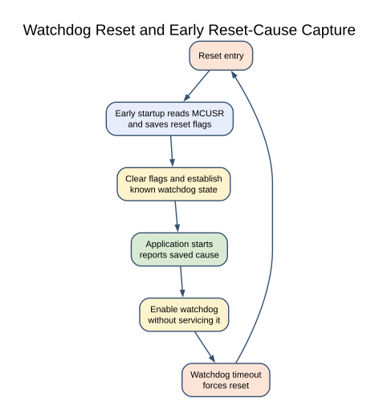

# Watchdog Timer and Reset Diagnosis

## What You Will Learn

The watchdog timer can reset the ATmega328P if firmware does not service it before the selected timeout. A product can use this as a recovery mechanism when the main program becomes stuck, but it must only feed the watchdog after checking that the required work is healthy.

Lab 44 deliberately does not feed the watchdog. It prints a raw reset-cause byte, enables a two-second watchdog timeout and then waits forever. The MCU should reset and repeat the demonstration.

## The Early Startup Hook



After a reset, the reset flags are held in `MCUSR`. Lab 44 uses an AVR startup hook in `.init3` to save the flags into a `.noinit` byte, clear `MCUSR` and disable a watchdog that may still be active. This happens before normal C variable initialization so the code can record the reset reason and establish a known watchdog state.

The printed byte is a raw bit field, not a ready-made message. The WDRF bit indicates a watchdog reset when it is still present. A bootloader may also inspect or change reset flags before the application starts, so the value is not a guarantee of the original event history on every board.

## Wiring and Serial Output

No external circuit is needed. Connect the Uno to the PC and open a 9600-baud serial terminal. A bootloader may emit its own messages or affect startup timing.

| Uno signal | Connection | Purpose |
| --- | --- | --- |
| D0 / RX, D1 / TX | USB serial bridge | Print the saved reset flags |
| GND | USB/PC reference | Serial signal ground |

Leave D0/D1 free of other modules while using the terminal. Do not use the watchdog lesson to alter fuses or bootloader settings.

## Build and Observe

```powershell
python atmega328p-labs/tools/build.py 44-watchdog --compiler gcc
python atmega328p-labs/tools/build.py 44-watchdog --compiler xc8
```

After uploading with the course bootloader workflow, the application prints a decimal reset flag, waits for the watchdog to reset it and starts again. The output may repeat every two seconds. This course has build validation only; watchdog behavior has not been observed on the physical Uno.

## Common Problems and Limits

- **The program resets before printing:** Check the bootloader and early startup behavior, then test with a known supported upload workflow.
- **The reset value is unexpected:** Decode the individual MCUSR bits and account for bootloader handling; do not assume the raw byte is a single cause code.
- **The application never resets:** Confirm the watchdog is enabled and the program does not accidentally feed it.
- **A product resets during long operations:** Feed only after a defined healthy checkpoint. Do not feed from a periodic ISR if the foreground can be deadlocked.
- **Startup hook is changed:** The `.init3` routine is toolchain-specific; preserve its naked startup requirements and verify the linked image.

## Code Walkthrough

### Watchdog reset diagnosis
The example's `main()` configures its peripherals, runs the algorithm and reports or displays the result. These source operations are listed in execution order:

- `(void)avr_uart_init(9600UL);` - Configures USART0 for asynchronous 8N1. It chooses a baud divisor and normal/double-speed mode, programs UBRR0/UCSR0A/UCSR0C, then enables receive and transmit in UCSR0B.
- `(void)avr_uart_u16(reset_reason);` - Formats an unsigned integer as decimal digits and sends them on USART0; it does not add a newline.
- `(void)avr_uart_put('\n', AVR_POLL_BUDGET);` - Waits for the USART transmit buffer within its poll budget, then writes the byte to UDR0.
- `wdt_enable(WDTO_2S);` - Enables the watchdog with the stated timeout. This example intentionally does not feed it so the reset can be observed.
- `for (;;)` - Repeats the foreground task indefinitely; each pass checks inputs, advances the calculation or services the peripheral shown below.

Algorithm: The .init3 hook disables a watchdog left running after reset before normal initialization. Bootloaders can alter MCUSR, so the reported reason is the value observed at application startup, not guaranteed original reset history.
Expected behaviour: Application deliberately resets after the watchdog interval
**HAL source files in this repository:** [ATmega328P HAL on GitHub](https://github.com/arnabdasbwn/atmega328p-hal)

- [`include/avr_hal/uart.h`](https://github.com/arnabdasbwn/atmega328p-hal/blob/main/include/avr_hal/uart.h)
- [`src/uart.c`](https://github.com/arnabdasbwn/atmega328p-hal/blob/main/src/uart.c)


## Check Your Understanding

1. Why does Lab 44 intentionally leave the watchdog unfed?
2. Why does the startup hook save reset flags before normal initialization?
3. Why should a production watchdog feed follow a health check?

**Suggested answers:** It demonstrates the reset interval and repeating startup. Normal C initialization can overwrite ordinary variables, so `.noinit` preserves the sampled flags. Feeding unconditionally can keep a faulty or stalled application alive instead of allowing recovery.

## Source and Further Reading

- [Lab 44 source](<https://github.com/arnabdasbwn/atmega328p-labs/blob/main/examples/44-watchdog/main.c>)
- [ATmega328P Documentation](https://www.microchip.com/en-us/product/ATMEGA328P), watchdog and reset-system sections.
- The compiler startup and linker documentation for the selected AVR toolchain explains its `.init` section conventions.
