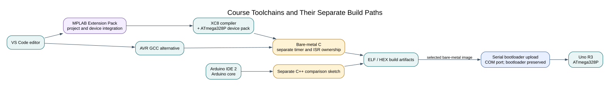

# Choosing MPLAB for VS Code and Arduino IDE

## Objectives and Prerequisites

This course uses **MPLAB for VS Code** with **XC8** to build register-level C for the ATmega328P. It uses **Arduino IDE 2** for separate sketches that compare the same idea using the Arduino core. The goal is to learn both the device and the tools without mixing two systems that manage the hardware differently.

## Why Use MPLAB for VS Code?

The Microchip extension pack adds Microchip toolchain and device workflows to VS Code. Microchip documents XC8 support for 8-bit AVR devices; the ATmega328P is selected with its matching device pack. The extension helps discover toolchains and work with Microchip projects, while the compiler itself performs the build. The course also includes command-line build tasks; those make the selected device, clock, source files and compiler options visible and repeatable.

Atmel Studio is not required. The course uses VS Code with the MPLAB extension pack and XC8, with AVR GCC available as a second command-line build path. Follow the dedicated setup lesson for current installation steps and version details.

## Why Keep Arduino IDE?

Arduino IDE is useful for comparing a small C++ sketch with a bare-metal C program. It supplies the Arduino core and board package. That core configures parts of the device and owns some interrupt vectors and timers. For this reason, comparison sketches are separate projects; do not link them with bare-metal HAL modules that claim the same resources.

The two workflows answer different learning questions:

| Workflow | What it teaches | What it handles for you |
| --- | --- | --- |
| XC8 bare-metal C | Registers, peripheral setup, timing and ownership | Compiler and device-pack integration |
| AVR GCC bare-metal C | A second compiler view of the same C interface | Tool discovery through the course build scripts |
| Arduino IDE sketch | A concise API for selected tasks | Arduino core startup and peripheral defaults |

Arduino is not inherently unsuitable for serious work, and direct register access is not automatically safer. Good design depends on clear ownership, documented assumptions, predictable timing and tests in either environment.

## Worked Comparison: Set an Output

In the register-level Blink example, the program selects the ATmega328P data-direction and output registers for the Uno's built-in LED. The Arduino comparison calls `pinMode()` and `digitalWrite()`. Both can produce a blinking LED; the first shows the port bits, while the second hides those details behind a board-level API.

Read the [first Blink lesson](first-blink.md), then build each project separately. Compare the source and build reports. Do not compare timing unless you measure it: compiler options, core setup and delay implementation can change the generated code.

## Exercise with Answer

Why are Arduino comparison sketches kept outside the bare-metal HAL project?

**Answer:** The Arduino core and the HAL can both configure or own the same timer, interrupt vector or peripheral. Keeping them as separate targets makes ownership explicit and prevents duplicate definitions or hidden configuration conflicts.

## Code Walkthrough

**Example code on GitHub:**
- [Register-level Blink (`01-blink-register`)](https://github.com/arnabdasbwn/atmega328p-labs/blob/main/examples/01-blink-register/main.c)
- [HAL Blink (`02-blink-hal`)](https://github.com/arnabdasbwn/atmega328p-labs/blob/main/examples/02-blink-hal/main.c)

### Register-level Blink
The example's `main()` configures its peripherals, runs the algorithm and reports or displays the result. These source operations are listed in execution order:

- `PORTB &= (uint8_t)~_BV(PORTB5);` - Sets or clears the Port B output latch. When the pin is an output, this determines its output level; on an input, it controls the pull-up.
- `DDRB |= _BV(DDB5);` - Sets the Port B direction bits; a set bit selects output mode.
- `for (;;)` - Repeats the foreground task indefinitely; each pass checks inputs, advances the calculation or services the peripheral shown below.
- `PINB = _BV(PINB5);` - Writing a one to a PINB bit toggles that pin's PORTB output latch on the ATmega328P.
- `_delay_ms(500);` - Waits for the stated interval; the foreground does no other work during this blocking delay.

Algorithm: Pin direction and output latch are separate hardware state.
Expected behaviour: L toggles every 500 ms
**HAL source files in this repository:** [ATmega328P HAL on GitHub](https://github.com/arnabdasbwn/atmega328p-hal)

### HAL Blink
The example's `main()` configures its peripherals, runs the algorithm and reports or displays the result. These source operations are listed in execution order:

- `if (avr_gpio_mode(AVR_BOARD_LED, AVR_GPIO_OUTPUT) != AVR_OK)` - This checks for any setup or transfer error before the program continues. Maps the Uno header pin to its AVR port, sets its DDR direction bit and prepares the PORT latch for the requested initial level or pull-up.
- `return 1;` - Stops this path and returns the indicated status when setup or validation cannot continue.
- `for (;;)` - Repeats the foreground task indefinitely; each pass checks inputs, advances the calculation or services the peripheral shown below.
- `(void)avr_gpio_toggle(AVR_BOARD_LED);` - Atomically toggles the selected pin output latch.
- `_delay_ms(500);` - Waits for the stated interval; the foreground does no other work during this blocking delay.

Algorithm: Pin direction and output latch are separate hardware state.
Expected behaviour: L toggles every 500 ms
**HAL source files in this repository:** [ATmega328P HAL on GitHub](https://github.com/arnabdasbwn/atmega328p-hal)

- [`include/avr_hal/gpio.h`](https://github.com/arnabdasbwn/atmega328p-hal/blob/main/include/avr_hal/gpio.h)
- [`src/gpio.c`](https://github.com/arnabdasbwn/atmega328p-hal/blob/main/src/gpio.c)

## References

- [Microchip: MPLAB Extensions for VS Code](https://developerhelp.microchip.com/xwiki/bin/view/software-tools/ides/extensions/)
- [Microchip: Toolchain discovery and extension setup](https://developerhelp.microchip.com/xwiki/bin/view/software-tools/ides/extensions/mplabx-to-vscode/setup/)
- [Microchip: MPLAB XC8 Compiler support](https://developerhelp.microchip.com/xwiki/bin/view/software-tools/compilers/xc8/)
- [Installing VS Code, MPLAB and XC8](install-mplab.md)
- [Arduino IDE 2 installation](https://docs.arduino.cc/software/ide-v2/tutorials/getting-started/ide-v2-downloading-and-installing/)
