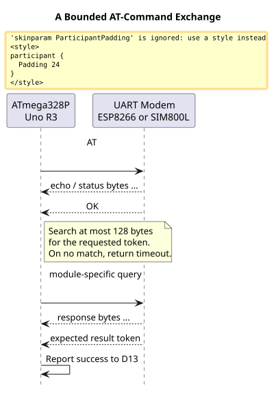
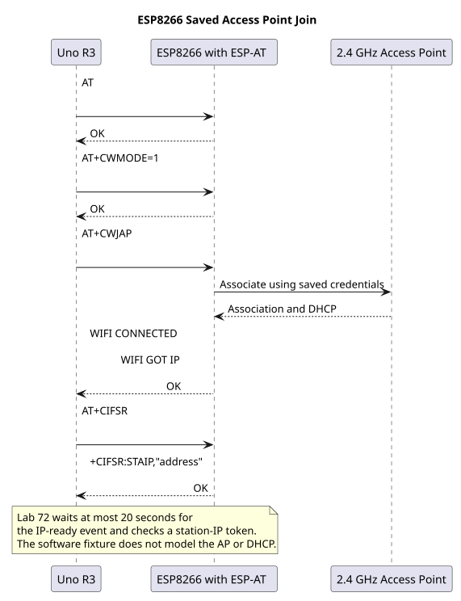
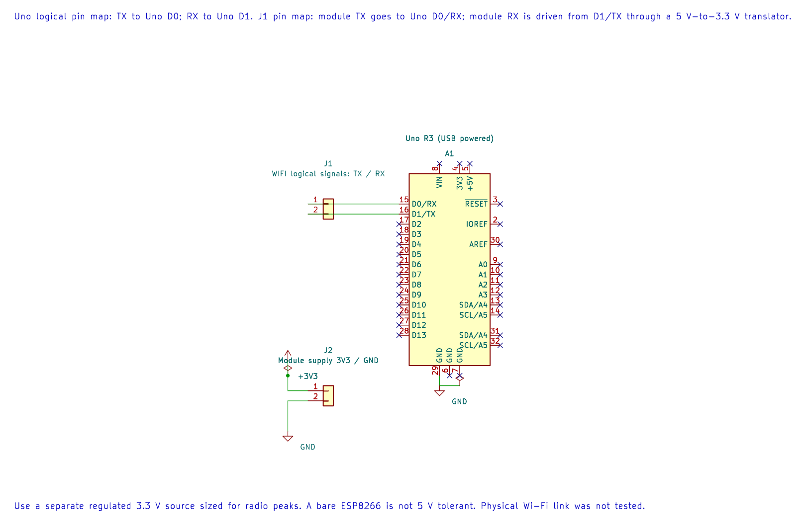

# ESP8266 At-Command Wi-Fi

## Learning Goals

In this lesson, you will check that an ESP8266 modem responds to AT commands and reports its firmware version. The ATmega328P sends each command through its USART, then waits for a short response token. This is an interface check; it does not connect to Wi-Fi.

The ESP8266 is a separate 3.3 V microcontroller with a radio. It needs its own suitable power source and correct boot configuration. A breakout that accepts 5 V supply may still have 3.3 V logic, so check the exact board documentation before wiring it.

## How the Command Exchange Works

An AT command is text sent over UART, usually ending in carriage return and line feed. The modem may echo the command and send several response lines before the final result. The course helper scans a bounded number of incoming bytes for a requested token. If it sees no token within that bound, it returns a timeout instead of waiting forever.



This small helper is useful for the first handshake, but it is not a complete modem protocol engine. It does not preserve response lines, distinguish every error, parse unsolicited events or coordinate multiple outstanding commands.

## Connect to a Saved Access Point

After the basic handshake, Lab 72 shows a real network command flow without putting the Wi-Fi name or password in firmware. Configure the ESP8266's AT firmware for station mode and provision the network credentials separately. Then the Uno can issue `AT+CWMODE=1`, `AT+CWJAP` to connect with the modem's saved network settings, and `AT+CIFSR` to query the station IP. The lab waits for `WIFI GOT IP` before reporting success.



The AP join can take several seconds, so Lab 72 uses Timer0's one-millisecond tick and a 20-second wrap-safe deadline for that step. Short AT commands use a separate three-second deadline. The token reader consumes response bytes and checks the expected state; it does not retain a diagnostic log or validate the contents of the IP address. The status LED turns on only after a station-IP response is present.

Set up the ESP-AT firmware with a network that you are authorised to use. Keep credentials out of source files, screenshots, serial logs and Git. The `AT+CWJAP` execute form uses the module's saved network configuration; the exact persistence behaviour depends on the ESP-AT build. If the module has no saved credentials, provision it with a suitable 3.3 V serial adapter and terminal, then remove that adapter before connecting the Uno. Use a 2.4 GHz network supported by the ESP8266 and the installed firmware.

## Parts and Wiring

Use an Uno R3, an ESP8266 breakout with AT firmware, a regulated supply suitable for that breakout, and a level shifter if the module RX pin is not 5 V tolerant. The project selects 9600 baud; configure the module for that rate first. Many boards use another default baud rate.

| Uno R3 | ESP8266 Breakout | Notes |
| --- | --- | --- |
| D1 / TX | RX through a suitable level shifter | The Uno TX output is 5 V logic. |
| D0 / RX | TX | Confirm the breakout TX level is safe for the Uno input. |
| GND | GND | Use a common ground. |
| Separate regulated supply | VCC | Match the breakout input voltage and radio current needs. Do not use an Uno GPIO as the supply. |
| 3.3 V logic supply | EN / CH_PD, GPIO0 and GPIO2 as required by the board | Follow the exact module boot-mode circuit. Do not assume every ESP-01 clone is identical. |

The Uno USB-to-serial bridge also connects to D0 and D1. Upload the program before connecting the modem, then disconnect the Uno USB data connection for this hardware UART test. Power the Uno and ESP8266 safely and keep their grounds joined. Reconnect USB only after removing the conflicting UART connection.



The editable KiCad pin map records the UART assignment. Keep the ESP8266 on its own suitable 3.3 V supply and level-shift the Uno TX output.

## Build and Run the Example

The maintained handshake example is [`55-esp8266-at`](https://github.com/arnabdasbwn/atmega328p-labs/blob/main/examples/55-esp8266-at/main.c). It sends `AT`, waits for `OK`, then sends `AT+GMR` and waits for its final `OK`. D13 turns on after both checks pass. A failure returns from `main`; D13 remains off.

For the network exercise, build [`72-esp8266-wifi-join`](https://github.com/arnabdasbwn/atmega328p-labs/blob/main/examples/72-esp8266-wifi-join/main.c):

```powershell
python atmega328p-labs/tools/build.py 72-esp8266-wifi-join --compiler gcc
python atmega328p-labs/tools/build.py 72-esp8266-wifi-join --compiler xc8
```

Lab 72 owns Timer0 for its deadline tick and USART0 for the modem. Do not combine it with the Arduino core, another Timer0 owner, or another USART driver in the same project. The tick enables a Timer0 interrupt; the foreground command code runs with global interrupts enabled.

From the course folder, build with either compiler:

```powershell
python atmega328p-labs/tools/build.py 55-esp8266-at --compiler gcc
python atmega328p-labs/tools/build.py 55-esp8266-at --compiler xc8
```

The source uses `avr_at_send()` and `avr_at_wait_token()` from the HAL. The wait limit is 128 received bytes for each token. At 9600 baud, a byte takes about 1.04 ms on an 8N1 link, but the helper's polling budget is a software loop count, not a calibrated millisecond timeout. A later revision should use a timer-based deadline when the application needs a predictable wall-clock response time.

`AT+GMR` reports firmware identity; Espressif recommends including that information when investigating AT firmware issues. The exact command set depends on the AT firmware build, so record the response with the module variant. See the [ESP-AT basic command reference](https://docs.espressif.com/projects/esp-at/en/release-v2.2.0.0_esp8266/AT_Command_Set/Basic_AT_Commands.html).

## Observe and Troubleshoot

With a compatible, preconfigured module and a supported access point, D13 should turn on after association, IP assignment and the station-IP query. It does not open a TCP connection or send application data over the network.

If D13 stays off, check the module supply at its pins while it is responding, common ground, crossed TX/RX wiring, UART voltage levels, baud rate, line ending and AT firmware. If the module prints startup text but never responds, check its boot-mode pins and whether the installed firmware actually supports AT commands. Avoid repeatedly increasing the byte bound before checking wiring and baud.

## Exercises

1. Why does the response helper limit the number of bytes it reads?
2. Why does a successful `AT` command not prove that Wi-Fi is connected?
3. Why does Lab 72 give the AP join a longer deadline than the `AT` handshake?
4. What information would you add to the response parser before sending a Wi-Fi password?

**Suggested answers:** The byte limit keeps processing bounded if the expected token never arrives. `AT` confirms only that the command interface responded; association and IP connectivity are later steps. Network association and DHCP take longer than a local handshake. A larger application should parse complete result lines, distinguish errors and unsolicited messages, validate state transitions, and keep credentials out of logs and source control.

## Validation and References

Both examples build with AVR GCC and XC8. AVR8js fixture [93-at-client-test](https://github.com/arnabdasbwn/atmega328p-labs/blob/main/examples/93-at-client-test/main.c) checks response-token matching, including overlapping prefixes. Fixture [97-esp8266-wifi-test](https://github.com/arnabdasbwn/atmega328p-labs/blob/main/examples/97-esp8266-wifi-test/main.c) reuses Lab 72 and supplies a scripted handshake, network-join and IP response over the modeled UART. It checks command flow and the D13 success state, but does not model radio association, an access point or DHCP. No physical ESP8266 test has been performed.

- [ESP-AT Basic AT Commands](https://docs.espressif.com/projects/esp-at/en/release-v2.2.0.0_esp8266/AT_Command_Set/Basic_AT_Commands.html)
- [ESP-AT TCP/IP Command Examples](https://docs.espressif.com/projects/esp-at/en/release-v2.2.0.0_esp8266/AT_Command_Examples/TCP-IP_AT_Examples.html)
- [ESP-AT Wi-Fi Commands](https://docs.espressif.com/projects/esp-at/en/release-v2.2.0.0_esp8266/AT_Command_Set/Wi-Fi_AT_Commands.html)
- [ATmega328P Device Documentation](https://www.microchip.com/en-us/product/ATMEGA328P)
- [Uno R3 Pinout](https://www.arnabkumardas.com/pinout/arduino-uno-r3/)

## Code Walkthrough

### ESP8266 AT Firmware Check
The example's `main()` configures its peripherals, runs the algorithm and reports or displays the result. These source operations are listed in execution order:

- `static const uint8_t at_command[] = "AT\r\n";` - Stores this intermediate or output value for the next algorithm step. Check the units and range represented by each operand.
- `static const uint8_t version_command[] = "AT+GMR\r\n";` - Stores this intermediate or output value for the next algorithm step. Check the units and range represented by each operand.
- `static const uint8_t ok_token[] = "OK";` - Stores this intermediate or output value for the next algorithm step. Check the units and range represented by each operand.
- `(void)avr_gpio_mode(13U, AVR_GPIO_OUTPUT);` - Maps the Uno header pin to its AVR port, sets its DDR direction bit and prepares the PORT latch for the requested initial level or pull-up.
- `(void)avr_gpio_write(13U, false);` - Changes the pin's PORT output latch; for an input pin this selects its pull-up state.
- `if (avr_uart_init(9600UL) != AVR_OK)` - This checks for any setup or transfer error before the program continues. Configures USART0 for asynchronous 8N1. It chooses a baud divisor and normal/double-speed mode, programs UBRR0/UCSR0A/UCSR0C, then enables receive and transmit in UCSR0B.
- `return 1;` - Stops this path and returns the indicated status when setup or validation cannot continue.
- `if ((avr_at_send(at_command, (sizeof(at_command) - 1U)) != AVR_OK) ||` - This checks for any setup or transfer error before the program continues. Use the linked public header for this function's parameters, register ownership, blocking behavior and status values.
- `(avr_at_wait_token(ok_token, 2U, AVR_ESP8266_RESPONSE_BYTES, AVR_POLL_BUDGET) != AVR_OK) ||` - Use the linked public header for this function's parameters, register ownership, blocking behavior and status values.
- `(avr_at_send(version_command, (sizeof(version_command) - 1U)) != AVR_OK) ||` - Use the linked public header for this function's parameters, register ownership, blocking behavior and status values.
- `(avr_at_wait_token(ok_token, 2U, AVR_ESP8266_RESPONSE_BYTES, AVR_POLL_BUDGET) != AVR_OK))` - Use the linked public header for this function's parameters, register ownership, blocking behavior and status values.
- `(void)avr_gpio_write(13U, true);` - Changes the pin's PORT output latch; for an input pin this selects its pull-up state.
- `for (;;)` - Repeats the foreground task indefinitely; each pass checks inputs, advances the calculation or services the peripheral shown below.
- `_delay_ms(1000);` - Waits for the stated interval; the foreground does no other work during this blocking delay.

Algorithm: A byte-bounded token matcher can ignore command echo and unrelated response text while still limiting how long foreground code waits.
Expected behaviour: D13 turns on after the module returns OK for AT and AT+GMR
**HAL source files in this repository:** [ATmega328P HAL on GitHub](https://github.com/arnabdasbwn/atmega328p-hal)

- [`include/avr_hal/gpio.h`](https://github.com/arnabdasbwn/atmega328p-hal/blob/main/include/avr_hal/gpio.h)
- [`include/avr_hal/uart.h`](https://github.com/arnabdasbwn/atmega328p-hal/blob/main/include/avr_hal/uart.h)
- [`lib/drivers/at_client.c`](https://github.com/arnabdasbwn/atmega328p-hal/blob/main/lib/drivers/at_client.c)
- [`lib/drivers/at_client.h`](https://github.com/arnabdasbwn/atmega328p-hal/blob/main/lib/drivers/at_client.h)
- [`src/gpio.c`](https://github.com/arnabdasbwn/atmega328p-hal/blob/main/src/gpio.c)
- [`src/uart.c`](https://github.com/arnabdasbwn/atmega328p-hal/blob/main/src/uart.c)


### ESP8266 Saved Access Point Join
The example's `main()` configures its peripherals, runs the algorithm and reports or displays the result. These source operations are listed in execution order:

- `static const uint8_t at_command[] = "AT\r\n";` - Stores this intermediate or output value for the next algorithm step. Check the units and range represented by each operand.
- `static const uint8_t mode_command[] = "AT+CWMODE=1\r\n";` - Stores this intermediate or output value for the next algorithm step. Check the units and range represented by each operand.
- `static const uint8_t join_command[] = "AT+CWJAP\r\n";` - Stores this intermediate or output value for the next algorithm step. Check the units and range represented by each operand.
- `static const uint8_t ip_command[] = "AT+CIFSR\r\n";` - Stores this intermediate or output value for the next algorithm step. Check the units and range represented by each operand.
- `static const uint8_t ok_token[] = "OK";` - Stores this intermediate or output value for the next algorithm step. Check the units and range represented by each operand.
- `static const uint8_t ip_token[] = "STAIP";` - Stores this intermediate or output value for the next algorithm step. Check the units and range represented by each operand.
- `static const uint8_t got_ip_token[] = "WIFI GOT IP";` - Stores this intermediate or output value for the next algorithm step. Check the units and range represented by each operand.
- `(void)avr_gpio_mode(13U, AVR_GPIO_OUTPUT);` - Maps the Uno header pin to its AVR port, sets its DDR direction bit and prepares the PORT latch for the requested initial level or pull-up.
- `(void)avr_gpio_write(13U, false);` - Changes the pin's PORT output latch; for an input pin this selects its pull-up state.
- `avr_tick_init();` - Configures the course millisecond tick interrupt source; it does not enable global interrupts itself.
- `if (avr_uart_init(9600UL) != AVR_OK)` - This checks for any setup or transfer error before the program continues. Configures USART0 for asynchronous 8N1. It chooses a baud divisor and normal/double-speed mode, programs UBRR0/UCSR0A/UCSR0C, then enables receive and transmit in UCSR0B.
- `return 1;` - Stops this path and returns the indicated status when setup or validation cannot continue.
- `sei();` - Enables global interrupts after the example has configured its sources and shared state.
- `if ((wifi_command(at_command, sizeof(at_command) - 1U, ok_token, 2U, WIFI_SHORT_TIMEOUT_MS) !=` - Tests this condition to choose which algorithm path runs.
- `WIFI_SHORT_TIMEOUT_MS) != AVR_OK) ||` - This statement advances the operation sequence; follow its expression to see the state change.
- `(avr_at_send(join_command, sizeof(join_command) - 1U) != AVR_OK) ||` - Calls `avr_at_send()`; its public HAL header defines the arguments, register ownership, blocking behavior and status results.
- `(wifi_wait_token_ms(got_ip_token, 11U, WIFI_RESPONSE_LIMIT, WIFI_JOIN_TIMEOUT_MS) !=` - This statement advances the operation sequence; follow its expression to see the state change.
- `(wifi_wait_token_ms(ok_token, 2U, WIFI_RESPONSE_LIMIT, WIFI_SHORT_TIMEOUT_MS) != AVR_OK) ||` - This statement advances the operation sequence; follow its expression to see the state change.
- `(wifi_command(ip_command, sizeof(ip_command) - 1U, ip_token, 5U, WIFI_SHORT_TIMEOUT_MS) !=` - This statement participates in the operation sequence; follow its expression to see which state or output changes.
- `(wifi_wait_token_ms(ok_token, 2U, WIFI_RESPONSE_LIMIT, WIFI_SHORT_TIMEOUT_MS) != AVR_OK))` - This statement participates in the operation sequence; follow its expression to see which state or output changes.
- `(void)avr_gpio_write(13U, true);` - Changes the pin's PORT output latch; for an input pin this selects its pull-up state.
- `for (;;)` - Repeats the foreground task indefinitely; each pass checks inputs, advances the calculation or services the peripheral shown below.

Algorithm: Uses a Timer0 millisecond tick for wrap-safe response deadlines; joins previously configured AP settings without storing credentials in source.
Expected behaviour: D13 turns on after ESP-AT reports WIFI GOT IP and a station-IP response
**HAL source files in this repository:** [ATmega328P HAL on GitHub](https://github.com/arnabdasbwn/atmega328p-hal)

- [`include/avr_hal/gpio.h`](https://github.com/arnabdasbwn/atmega328p-hal/blob/main/include/avr_hal/gpio.h)
- [`include/avr_hal/tick.h`](https://github.com/arnabdasbwn/atmega328p-hal/blob/main/include/avr_hal/tick.h)
- [`include/avr_hal/uart.h`](https://github.com/arnabdasbwn/atmega328p-hal/blob/main/include/avr_hal/uart.h)
- [`lib/drivers/at_client.c`](https://github.com/arnabdasbwn/atmega328p-hal/blob/main/lib/drivers/at_client.c)
- [`lib/drivers/at_client.h`](https://github.com/arnabdasbwn/atmega328p-hal/blob/main/lib/drivers/at_client.h)
- [`lib/interrupts/tick.c`](https://github.com/arnabdasbwn/atmega328p-hal/blob/main/lib/interrupts/tick.c)
- [`src/gpio.c`](https://github.com/arnabdasbwn/atmega328p-hal/blob/main/src/gpio.c)
- [`src/uart.c`](https://github.com/arnabdasbwn/atmega328p-hal/blob/main/src/uart.c)


### AT Client Response Matcher Fixture
The example's `main()` configures its peripherals, runs the algorithm and reports or displays the result. These source operations are listed in execution order:

- `static const uint8_t command[] = "AT\r\n";` - Stores this intermediate or output value for the next algorithm step. Check the units and range represented by each operand.
- `static const uint8_t ok_token[] = "OK";` - Stores this intermediate or output value for the next algorithm step. Check the units and range represented by each operand.
- `static const uint8_t repeated_prefix_token[] = "ABABAC";` - Stores this intermediate or output value for the next algorithm step. Check the units and range represented by each operand.
- `static const uint8_t first_marker[] = "WAIT1\n";` - Stores this intermediate or output value for the next algorithm step. Check the units and range represented by each operand.
- `static const uint8_t second_marker[] = "WAIT2\n";` - Stores this intermediate or output value for the next algorithm step. Check the units and range represented by each operand.
- `(void)avr_uart_init(9600UL);` - Configures USART0 for asynchronous 8N1. It chooses a baud divisor and normal/double-speed mode, programs UBRR0/UCSR0A/UCSR0C, then enables receive and transmit in UCSR0B.
- `if (avr_at_send(command, (sizeof(command) - 1U)) != AVR_OK)` - This checks for any setup or transfer error before the program continues. Use the linked public header for this function's parameters, register ownership, blocking behavior and status values.
- `(void)avr_uart_write((const uint8_t *)"FAIL\n", 5U, AVR_POLL_BUDGET);` - Sends the specified bytes through USART0; a timeout can occur after a prefix has already been sent.
- `return 1;` - Stops this path and returns the indicated status when setup or validation cannot continue.
- `(void)avr_uart_write(first_marker, (sizeof(first_marker) - 1U), AVR_POLL_BUDGET);` - Sends the specified bytes through USART0; a timeout can occur after a prefix has already been sent.
- `if (avr_at_wait_token(ok_token, 2U, 32U, 10000UL) != AVR_OK)` - Takes the error path if setup or transfer fails.
- `(void)avr_uart_write(second_marker, (sizeof(second_marker) - 1U), AVR_POLL_BUDGET);` - Sends the specified bytes through USART0; a timeout can occur after a prefix has already been sent.
- `if (avr_at_wait_token(repeated_prefix_token, 6U, 32U, 10000UL) != AVR_OK)` - This checks for any setup or transfer error before the program continues. Use the linked public header for this function's parameters, register ownership, blocking behavior and status values.
- `(void)avr_uart_write((const uint8_t *)"PASS\n", 5U, AVR_POLL_BUDGET);` - Sends the specified bytes through USART0; a timeout can occur after a prefix has already been sent.
- `return 0;` - Stops this path and returns the indicated status when setup or validation cannot continue.

Algorithm: A bounded prefix matcher can find response tokens across arbitrary intervening bytes without allocating an unbounded response string.
Expected behaviour: The fixture prints PASS after matching OK following ERROR text and matching a token with a repeated prefix
**HAL source files in this repository:** [ATmega328P HAL on GitHub](https://github.com/arnabdasbwn/atmega328p-hal)

- [`include/avr_hal/uart.h`](https://github.com/arnabdasbwn/atmega328p-hal/blob/main/include/avr_hal/uart.h)
- [`lib/drivers/at_client.c`](https://github.com/arnabdasbwn/atmega328p-hal/blob/main/lib/drivers/at_client.c)
- [`lib/drivers/at_client.h`](https://github.com/arnabdasbwn/atmega328p-hal/blob/main/lib/drivers/at_client.h)
- [`src/uart.c`](https://github.com/arnabdasbwn/atmega328p-hal/blob/main/src/uart.c)


### ESP8266 Timed Join Software Fixture
The example's `main()` configures its peripherals, runs the algorithm and reports or displays the result. These source operations are listed in execution order:


Algorithm: Checks command order and bounded time-based response matching using simulated UART bytes.
Expected behaviour: Scripted AT responses lead Lab 72 to its D13 success state
**HAL source files in this repository:** [ATmega328P HAL on GitHub](https://github.com/arnabdasbwn/atmega328p-hal)

- [`lib/interrupts/tick.c`](https://github.com/arnabdasbwn/atmega328p-hal/blob/main/lib/interrupts/tick.c)
