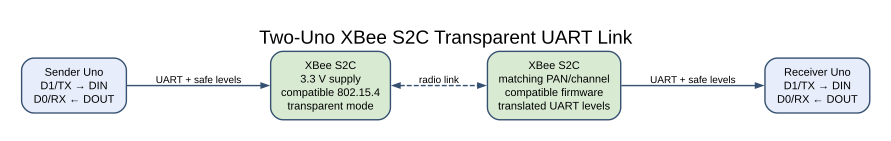
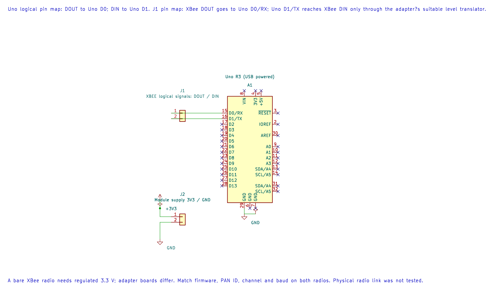

# XBee S2C Serial Radio Link

## What You Will Learn

An XBee module provides a serial interface to a radio link. The microcontroller sends and receives UART bytes; the module handles the radio packet details according to its firmware and configuration.

This lesson uses two XBee S2C modules in transparent mode. One Uno sends a short numbered line, and the other checks the line before toggling an LED. The example demonstrates UART framing and input validation. It does not configure the radios, prove RF delivery from the sender, or implement an acknowledgement protocol.

## Check the Exact XBee Variant

“XBee” covers several product families with different firmware, radio protocols, pinouts and configuration tools. The labs target XBee S2C 802.15.4 modules using compatible firmware and a UART-connected adapter. They are not automatically compatible with Zigbee, DigiMesh, newer XBee generations or modules from other vendors.

The S2C radio module uses low-voltage power and logic. Use a breakout that provides the required supply and safe UART levels, or add a suitable level translator. Do not connect a bare module to 5 V Uno pins. Digi lists a 2.8–3.4 V supply range for the 802.15.4 S2C module; always confirm the value in the [specific module guide and datasheet](https://www.digi.com/resources/documentation/digidocs/pdfs/90001500.pdf) for the exact part and board.

## Configure the Two Modules





The editable KiCad pin map records the UART assignment. Bare radios need regulated 3.3 V and level translation; adapter-board features vary.

Before connecting them to the Uno boards, use the vendor's configuration tool and a supported adapter to configure both radios. Set matching network parameters, including the PAN ID and channel, and set the module UART to 9600 baud. Confirm that both modules use compatible 802.15.4 firmware and roles. Save a record of the exact firmware and configuration used with the experiment.

The bare-metal firmware does not enter command mode or change radio settings. This avoids mixing module configuration with the first UART exercise.

## Wiring

Make one set of connections for each Uno and adapter. UART transmit and receive cross over:

| Uno R3 | XBee adapter | Purpose |
| --- | --- | --- |
| D1 / TX | DIN through level translation | Uno sends bytes to radio |
| D0 / RX | DOUT through level translation | Uno receives bytes from radio |
| GND | GND | Shared signal reference |
| Adapter's documented supply | VCC | Stable module power |
| D4 through 1 kΩ (receiver only) | LED anode; cathode to GND | Valid-record indicator |

Do not connect two Uno boards' TX outputs together. Each board connects only to its own radio. Avoid using the Uno's USB serial monitor at the same time as these examples: its USB interface also uses D0 and D1.

## The Message Format

Lab 61 sends one line per second:

```text
UNO1:<sequence>\n
```

The sequence is an unsigned value from 0 to 255 and wraps back to zero. Lab 62 accepts one to three decimal digits, rejects out-of-range values and malformed lines, and changes D4 only after a complete valid line arrives. Each byte read uses a bounded polling operation so a disconnected radio does not hold the receiver forever.

In transparent mode the radio forwards serial data according to its configuration. A successful USART write only confirms that the local microcontroller accepted a byte for transmission; it does not prove that the remote radio received it. The receiver-side indicator is the observation for this lab. A product that needs delivery confirmation should add a reply message and timeout at the application layer or use a suitable framed mode.

## Build and Try the Examples

Build the sender and receiver separately:

```powershell
python atmega328p-labs/tools/build.py 61-xbee-sender --compiler gcc
python atmega328p-labs/tools/build.py 62-xbee-receiver --compiler gcc
python atmega328p-labs/tools/build.py 61-xbee-sender --compiler xc8
python atmega328p-labs/tools/build.py 62-xbee-receiver --compiler xc8
```

The build commands do not upload firmware. Program each Uno through its serial bootloader using the course upload instructions. Power the radios only after checking their adapter labels and wiring.

With both radios powered and configured, D4 on the receiver should toggle once for each valid line. Disconnect or power down the sending radio and observe that the receiver leaves the LED unchanged. Restore the link and check that valid records resume.

## Troubleshooting

- **No LED changes:** Check the module UART baud, crossed TX/RX signals, common ground and matching network settings.
- **The modules reset during transmission:** Check the radio supply and local decoupling. A weak supply can cause intermittent links.
- **The Uno behaves strangely while connected to USB:** Disconnect the XBee adapter from D0/D1 while uploading or using the USB serial monitor.
- **The sender counter advances but the receiver misses a line:** The sender has no radio acknowledgement. Compare receiver records or add an application response.
- **Different XBee products do not communicate:** Check the exact model, protocol family and firmware. The S2C 802.15.4 example is not a universal XBee setup guide.

## Code Walkthrough


**Example code on GitHub:**
- [XBee S2C Transparent-Mode Sender (`61-xbee-sender`)](https://github.com/arnabdasbwn/atmega328p-labs/blob/main/examples/61-xbee-sender/main.c)
- [XBee S2C Transparent-Mode Receiver (`62-xbee-receiver`)](https://github.com/arnabdasbwn/atmega328p-labs/blob/main/examples/62-xbee-receiver/main.c)

### XBee S2C Transparent-Mode Sender
The example's `main()` configures its peripherals, runs the algorithm and reports or displays the result. These source operations are listed in execution order:

- `uint8_t sequence = 0U;` - Clears the state/counter after its threshold is reached so the next interval starts from zero.
- `if (avr_uart_init(UINT32_C(9600)) != AVR_OK)` - This checks for any setup or transfer error before the program continues. Configures USART0 for asynchronous 8N1. It chooses a baud divisor and normal/double-speed mode, programs UBRR0/UCSR0A/UCSR0C, then enables receive and transmit in UCSR0B.
- `return 1;` - Stops this path and returns the indicated status when setup or validation cannot continue.
- `for (;;)` - Repeats the foreground task indefinitely; each pass checks inputs, advances the calculation or services the peripheral shown below.
- `if (avr_xbee_send_record(sequence) != AVR_OK)` - This checks for any setup or transfer error before the program continues. Use the linked public header for this function's parameters, register ownership, blocking behavior and status values.
- `sequence++;` - Advances the event/sample counter once for the condition just observed.
- `_delay_ms(1000);` - Waits for the stated interval; the foreground does no other work during this blocking delay.

Algorithm: Transparent mode presents received radio bytes at the module UART. USART transmission success does not prove over-air delivery.
Expected behaviour: The paired receiver sees one ASCII line per second, beginning UNO1:, with the sequence increasing modulo 256
**HAL source files in this repository:** [ATmega328P HAL on GitHub](https://github.com/arnabdasbwn/atmega328p-hal)

- [`include/avr_hal/uart.h`](https://github.com/arnabdasbwn/atmega328p-hal/blob/main/include/avr_hal/uart.h)
- [`src/uart.c`](https://github.com/arnabdasbwn/atmega328p-hal/blob/main/src/uart.c)


### XBee S2C Transparent-Mode Receiver
The example's `main()` configures its peripherals, runs the algorithm and reports or displays the result. These source operations are listed in execution order:

- `bool led = false;` - Stores this intermediate or output value for the next algorithm step. Check the units and range represented by each operand.
- `if ((avr_gpio_mode(4U, AVR_GPIO_OUTPUT) != AVR_OK) || (avr_uart_init(UINT32_C(9600)) != AVR_OK))` - This checks for any setup or transfer error before the program continues. Maps the Uno header pin to its AVR port, sets its DDR direction bit and prepares the PORT latch for the requested initial level or pull-up. Configures USART0 for asynchronous 8N1. It chooses a baud divisor and normal/double-speed mode, programs UBRR0/UCSR0A/UCSR0C, then enables receive and transmit in UCSR0B.
- `return 1;` - Stops this path and returns the indicated status when setup or validation cannot continue.
- `for (;;)` - Repeats the foreground task indefinitely; each pass checks inputs, advances the calculation or services the peripheral shown below.
- `uint8_t sequence = 0U;` - Clears the state/counter after its threshold is reached so the next interval starts from zero.
- `if (avr_xbee_read_record(&sequence) == AVR_OK)` - The operation runs only after this API reports AVR_OK. Use the linked public header for this function's parameters, register ownership, blocking behavior and status values.
- `led = !led;` - Stores this intermediate or output value for the next algorithm step. Check the units and range represented by each operand.
- `if (avr_gpio_write(4U, led) != AVR_OK)` - This checks for any setup or transfer error before the program continues. Changes the pin's PORT output latch; for an input pin this selects its pull-up state.

Algorithm: A bounded parser validates framing and value range before updating the visible state.
Expected behaviour: D4 toggles for each newline-terminated UNO1 record with a decimal sequence from 0 through 255
**HAL source files in this repository:** [ATmega328P HAL on GitHub](https://github.com/arnabdasbwn/atmega328p-hal)

- [`include/avr_hal/gpio.h`](https://github.com/arnabdasbwn/atmega328p-hal/blob/main/include/avr_hal/gpio.h)
- [`include/avr_hal/uart.h`](https://github.com/arnabdasbwn/atmega328p-hal/blob/main/include/avr_hal/uart.h)
- [`src/gpio.c`](https://github.com/arnabdasbwn/atmega328p-hal/blob/main/src/gpio.c)
- [`src/uart.c`](https://github.com/arnabdasbwn/atmega328p-hal/blob/main/src/uart.c)


### XBee Record Parser Software Fixture
The example's `main()` configures its peripherals, runs the algorithm and reports or displays the result. These source operations are listed in execution order:

- `uint8_t sequence = 0U;` - Clears the state/counter after its threshold is reached so the next interval starts from zero.
- `if (avr_uart_init(UINT32_C(9600)) != AVR_OK)` - This checks for any setup or transfer error before the program continues. Configures USART0 for asynchronous 8N1. It chooses a baud divisor and normal/double-speed mode, programs UBRR0/UCSR0A/UCSR0C, then enables receive and transmit in UCSR0B.
- `return 1;` - Stops this path and returns the indicated status when setup or validation cannot continue.
- `(void)avr_uart_write((const uint8_t *)"V\n", 2U, AVR_XBEE_UART_BUDGET);` - Sends the specified bytes through USART0; a timeout can occur after a prefix has already been sent.
- `if ((avr_xbee_read_record(&sequence) != AVR_OK) || (sequence != UINT8_MAX))` - This checks for any setup or transfer error before the program continues. Use the linked public header for this function's parameters, register ownership, blocking behavior and status values.
- `(void)avr_uart_write((const uint8_t *)"FAIL\n", 5U, AVR_XBEE_UART_BUDGET);` - Sends the specified bytes through USART0; a timeout can occur after a prefix has already been sent.
- `(void)avr_uart_write((const uint8_t *)"I\n", 2U, AVR_XBEE_UART_BUDGET);` - Sends the specified bytes through USART0; a timeout can occur after a prefix has already been sent.
- `if ((avr_xbee_read_record(&sequence) != AVR_ERROR_UNSUPPORTED) || (sequence != UINT8_MAX))` - This condition chooses the next path based on the API result. Use the linked public header for this function's parameters, register ownership, blocking behavior and status values.
- `(void)avr_uart_write((const uint8_t *)"PASS\n", 5U, AVR_XBEE_UART_BUDGET);` - Sends the specified bytes through USART0; a timeout can occur after a prefix has already been sent.
- `for (;;)` - Repeats the foreground task indefinitely; each pass checks inputs, advances the calculation or services the peripheral shown below.

Algorithm: The test executes the exact bounded parser used by Lab 62 against deterministic serial input.
Expected behaviour: AVR8js USART output contains PASS after accepting sequence 255 and rejecting 256 without modifying the prior output
**HAL source files in this repository:** [ATmega328P HAL on GitHub](https://github.com/arnabdasbwn/atmega328p-hal)


## Check Your Understanding

1. What does a successful `avr_uart_write` tell you, and what does it not tell you?
2. Why does the receiver wait for a newline before toggling the LED?
3. What extra message could you add to detect a missing record at the sender?

**Suggested answers:** It tells you that bytes were accepted by the local USART, not that the remote radio received them. Waiting for a newline lets the program validate a complete record before changing state. The receiver could send an acknowledgement containing the sequence number, and the sender could use a timeout and bounded retry policy.

## Validation

Labs 61 and 62 build with AVR GCC and XC8. The [96-xbee-parser-test fixture](https://github.com/arnabdasbwn/atmega328p-labs/blob/main/examples/96-xbee-parser-test/main.c) checks valid and malformed records with scripted UART input. It does not model an XBee radio or physical delivery. No XBee modules or second Uno were available for a link test.

## Source and Further Reading

- [Digi XBee/XBee-PRO S2C 802.15.4 User Guide](https://www.digi.com/resources/documentation/digidocs/pdfs/90001500.pdf)
- [Digi XBee S2C Product Page](https://www.digi.com/products/embedded-systems/digi-xbee/rf-modules/2-4-ghz-rf-modules/xbee-802-15-4)
- [Microchip ATmega328P Documentation](https://www.microchip.com/en-us/product/ATMEGA328P)
